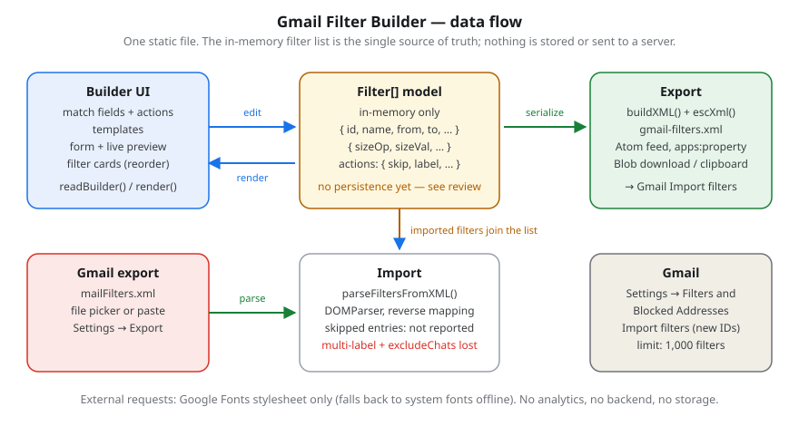

# Gmail Filter Builder

Build Gmail filters by dragging blocks — no account, no sign-in, no server. Assemble match rules and actions in your browser, then download one file and import it straight into Gmail.

**Live site:** https://enonymous1.github.io/gmail-filter-builder/

<!-- SCREENSHOT 1 — docs/assets/hero.png (1280×720, light theme)
     Place here, directly under the description above. Must show: the hero
     headline, the five template cards, the builder on the left with the
     Newsletters template loaded, and two filter cards in the list on the
     right. Capture at 1280×720 from the live site; do not mock it.
     Replace this comment with:  -->

## Description

Gmail's filter settings are a wall of small text fields. This app turns them into something you can see: pick what a message matches (From, To, Subject, Has the words, Doesn't have, Has attachment, Size) and what Gmail should do with it (Skip the Inbox, Mark as read, Star it, Apply a label, Categorize as, Forward it to, Delete it, Never send to Spam, Always / Never mark as important), stack up as many filters as you need, drag the cards to reorder them, and export the set as Gmail's own import file.

The export uses Gmail's own filter format — an Atom feed with one `<entry>` per filter and `apps:property` entries for each criterion and action (for example `shouldArchive` for Skip the Inbox, and `size` + `sizeOperator` + `sizeUnit` for a size condition). That is the exact format Gmail produces under **Export filters** and accepts under **Import filters**, so a file from this app imports cleanly and can be re-exported later. The app can also read a Gmail export back in, so you can edit your existing filters here and re-export them.

Everything runs locally in your browser. There is no backend, no account, and no data sent anywhere. Filters live only in the page while it is open — close the tab and the list is gone, so download your file when you are happy with it.

### Features

- Drag-or-tap match blocks (From, To, Subject, Has / Doesn't have words, Size, Has attachment) and action blocks (Star it, Skip Inbox, Apply a label, Delete it)
- Five one-tap templates: Newsletters, Receipts & invoices, Social notifications, Big attachments, VIP sender
- Live Gmail-search preview for the filter you are building (`from:(…) subject:(…) larger:10M …`)
- Filter list with drag-to-reorder, edit, duplicate, and delete
- Export as `gmail-filters.xml` (download or copy to clipboard), with a live XML preview
- Import an existing Gmail `mailFilters.xml` export (file picker or paste) and edit those filters
- System-aware light / dark theme; responsive down to mobile widths

### Known limitations

- **No persistence.** There is no save, no localStorage, and no JSON backup yet — a refresh wipes the list. Download the XML before closing the tab. (Tracking as the top follow-up; see [Staff review](docs/STAFF-REVIEW.md).)
- **No 1,000-filter guard.** Gmail rejects filter sets over 1,000 filters; the app does not warn you yet. Keep your list under 1,000.
- **Import is lossy in two cases.** A filter that applies two labels keeps only the last one, and `excludeChats` is dropped on import. Both are documented in the review.
- **No automated tests or CI yet.** Verification today is the manual checklist in [Local Development](#local-development).

## Prerequisites

- A modern browser: Chrome, Edge, Firefox, or Safari (current versions; the app uses `color-mix()`, `Blob` downloads, and the Clipboard API with an `execCommand` fallback)
- Git, if you want to clone the repository instead of downloading it
- Nothing else. There is no Node.js, no build step, no package manager, and no API key.

## Installation

```sh
git clone https://github.com/enonymous1/gmail-filter-builder.git
cd gmail-filter-builder
```

No install step — there are no dependencies to install. The whole app is `index.html` (plus this README, `LICENSE`, and an empty `.nojekyll` so GitHub Pages serves it as-is).

Alternatively, download the repository as a ZIP from GitHub and extract it. Either way, you have everything.

### Repository layout

```
gmail-filter-builder/
├── index.html            # The entire app: markup, CSS, and JavaScript in one file
├── README.md             # This file
├── LICENSE               # MIT
├── .nojekyll            # Tells GitHub Pages not to run Jekyll
└── docs/
    ├── STAFF-REVIEW.md   # Staff-level code review (2026-11-13) with prioritized fixes
    └── assets/
        ├── architecture.svg   # Data-flow diagram (referenced below)
        ├── hero.png           # Screenshot — capture before publishing (see shot list)
        ├── import-dialog.png  # Screenshot — capture before publishing
        └── round-trip.gif     # Animated demo — capture before publishing
```

## Local Development

Open the file directly — it works from `file://`, since the app makes no network requests of its own (the only external request is the Google Fonts stylesheet, which falls back to system fonts offline):

```sh
open index.html        # macOS
xdg-open index.html    # Linux
start index.html       # Windows
```

For behaviour closest to the deployed site (correct MIME type, no `file://` quirks), serve the folder instead:

```sh
python3 -m http.server 8000
# then open http://localhost:8000/
```

There is no build, no watcher, and no test runner. Edit `index.html`, refresh the browser, and check the change. That is the whole loop — and that is also the main architectural weakness the staff review calls out: the app is one 905-line file with no modules, no types, and no tests, so the review proposes splitting it into modules and adding a test harness before the next feature lands.

### Manual smoke checklist (until tests exist)

1. Load the **Newsletters** template, tap **Add filter** — a third card appears and the XML preview regenerates.
2. Drag a filter card above another — the order changes and the XML entry order follows it.
3. Click **Download .xml** — the file contains `<feed xmlns="http://www.w3.org/2005/Atom">`, `<title>Mail Filters</title>`, and `shouldArchive` (not `shouldSkipArchive`) for a Skip-Inbox filter.
4. Import that same file back via **Import XML** — the filters reappear with Skip Inbox and size intact.
5. Try adding a filter with no match and no action — the form shows an error and adds nothing.
6. Toggle the OS light/dark theme — the page follows it, with no unreadable text in either mode.

## Deployment

This is a static site. Any static host works; GitHub Pages is the default.

### GitHub Pages (recommended)

1. Push `main` to GitHub (see the push commands in the release notes, or `git push -u origin main`).
2. In the repository: **Settings → Pages → Build and deployment → Source: Deploy from a branch → Branch: `main`, Folder: `/ (root)`**.
3. The site publishes at `https://enonymous1.github.io/gmail-filter-builder/`. No build step runs; Pages serves `index.html` directly. The `.nojekyll` file is what keeps Pages from processing the site with Jekyll.

### Any other static host

Upload `index.html` (and `.nojekyll`, if the host is GitHub Pages) to the host's web root — Netlify Drop, Cloudflare Pages, Vercel, or any plain file server. No server-side code, environment variables, or redirects are needed.

## Usage

<!-- ANIMATED GIF — docs/assets/round-trip.gif (max 15 s, 1280×720)
     Place here, at the top of Usage. Must show the full round trip, no cuts:
     load the Newsletters template → Add filter → drag the new card above the
     first → Download .xml → open Gmail Settings → Filters and Blocked
     Addresses → Import filters → the new filter appears. Record it on the
     real site with real Gmail; do not mock it.
     Replace this comment with:  -->

1. Open the site.
2. Fill in the builder, or tap a template to load it and edit anything before adding.
3. Click **Add filter**. Drag filter cards to reorder them, or edit, duplicate, and delete them.
4. Click **Download .xml** to save `gmail-filters.xml`.

### Import into Gmail

<!-- SCREENSHOT 2 — docs/assets/import-dialog.png (1280×720)
     Place here, directly under this heading. Must show Gmail's own import
     dialog: Settings → See all settings → Filters and Blocked Addresses →
     Import filters, with gmail-filters.xml selected and the filter list
     shown before clicking "Create filters". Capture in real Gmail.
     Replace this comment with:  -->

1. In Gmail on desktop: gear icon → **See all settings** → **Filters and Blocked Addresses** tab.
2. Click **Import filters**, choose the downloaded `gmail-filters.xml`, then **Create filters**.
3. Tick **Also apply filter to matching conversations** in Gmail if you want it to clean up mail you already have.

Import creates new filters — it does not overwrite your existing ones. Try it with one filter first before importing a large set, and stay under Gmail's 1,000-filter limit.

### Import existing filters into the app

Export your current filters from Gmail (same tab → **Export**), then in the app open **Import filters you already have** and either choose the `.xml` file or paste the XML. Imported filters are added to your list, where you can reorder, edit, and re-export them. Two filters with the same match are kept as-is — the app does not de-duplicate yet.

## Architecture

The app is deliberately boring: one static file, no framework, no backend. The data flow is a straight line in both directions, with an in-memory list of plain filter objects in the middle.



- **Model:** an array of plain filter objects (`{ id, name, from, to, subject, has, hasNot, attach, sizeOp, sizeVal, sizeUnit, actions }`). No class, no store — that is the first thing the staff review would change.
- **Export:** `buildXML()` serializes the model to Gmail's Atom-feed XML, with `escXml()` escaping every value. The property-name mapping is the load-bearing contract — see the table in the review.
- **Import:** `parseFiltersFromXML()` runs the reverse mapping through `DOMParser`, keeping Gmail's property names as the source of truth and the app's old names only as a backwards-compatibility fallback.
- **View:** `render()` rebuilds the filter list DOM from the model on every change. Simple and correct at small sizes; wasteful past a few hundred filters (no virtualization, no `DocumentFragment`).

For the full analysis — what is solid, what is fragile, and what to fix first — read [docs/STAFF-REVIEW.md](docs/STAFF-REVIEW.md).

## Privacy

Everything runs locally in your browser. No account, no server, no analytics, no data sent anywhere. The only network request the page makes is to Google Fonts for its two typefaces, which degrade to system fonts offline.

## Contributing

Issues and pull requests are welcome. Keep the constraints that make this project what it is:

- Static only — no backend, no build step, no framework.
- The XML property names must match Gmail's export format exactly. If you touch `propsFor()` or `parseFiltersFromXML()`, verify the round trip with the checklist in [Local Development](#local-development).
- One clear change per pull request, with the manual checklist run and its results pasted in the PR description until automated tests exist.

## License

MIT — see [LICENSE](LICENSE).
